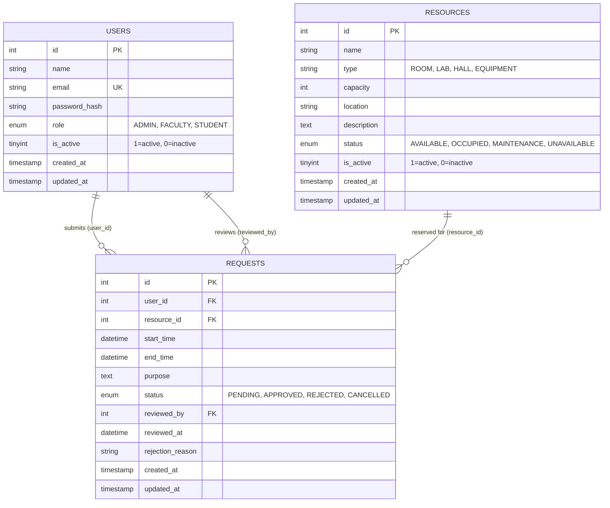

# Smartly — Database Architecture & Setup Guide

**Smartly: Access Flow Control Management System API**  
**Role:** Member 2 — Database Schema, MySQL Integration, and Data Layer  
**Target Branch:** `feature/member-2-database`

---

## 1. Architecture Overview

Smartly's persistent data layer is implemented in **MySQL** using the **InnoDB storage engine** and `utf8mb4` character encoding for full Unicode compatibility. The database layer isolates raw SQL queries inside repositories located in `backend/repositories/`, communicating through a connection pool managed by `mysql2/promise` in `backend/config/db.js`.

### Key Design Pillars
- **Strict Separation of Concerns:** Database interaction is strictly sequestered within the repository layer. Controllers and services consume domain objects, never raw SQL.
- **Contract Alignment:** Maintains exact schema compatibility with Member 1's authentication layer (`id`, `name`, `email`, `password_hash`, `role`, `is_active`).
- **Data Integrity & Relational Constraints:** Foreign key constraints with `CASCADE` on entity deletion and `SET NULL` on reviewer deletion prevent orphan records. A `CHECK` constraint prevents inverted booking time windows.
- **Optimized Indexing:** Indexed on foreign keys, operational status, user roles, and a composite index on `(resource_id, start_time, end_time)` for O(log N) booking conflict checks.
- **Compatibility Layer:** Includes SQL views (`rooms`, `bookings`) and adapter repositories (`roomRepository`, `bookingRepository`) so downstream modules (Members 3 and 4) can use either resource/request or room/booking nomenclature without conflict.

---

## 2. Entity-Relationship Diagram



---

## 3. Data Dictionary

### 3.1 `users` Table
Stores user accounts for authentication and role-based access control. Adheres directly to Member 1's authentication contract.

| Column | Type | Nullable | Default | Description / Constraints |
| :--- | :--- | :---: | :---: | :--- |
| `id` | `INT AUTO_INCREMENT` | No | — | Primary Key. |
| `name` | `VARCHAR(255)` | No | — | User full display name. |
| `email` | `VARCHAR(255)` | No | — | User unique login email (`uq_users_email`). |
| `password_hash` | `VARCHAR(255)` | No | — | Bcrypt-hashed password. |
| `role` | `ENUM('ADMIN', 'FACULTY', 'STUDENT')` | No | `'STUDENT'` | Access level for role-based authorization. |
| `is_active` | `TINYINT(1)` | No | `1` | Account status flag (`1` = active, `0` = deactivated). |
| `created_at` | `TIMESTAMP` | No | `CURRENT_TIMESTAMP` | Account creation timestamp. |
| `updated_at` | `TIMESTAMP` | No | `CURRENT_TIMESTAMP ON UPDATE CURRENT_TIMESTAMP` | Last profile update timestamp. |

**Indexes:**
- `PRIMARY KEY (id)`
- `UNIQUE KEY uq_users_email (email)`
- `INDEX idx_users_role (role)`
- `INDEX idx_users_is_active (is_active)`

---

### 3.2 `resources` Table
Represents facilities, rooms, computer labs, auditoriums, and reservable campus equipment.

| Column | Type | Nullable | Default | Description / Constraints |
| :--- | :--- | :---: | :---: | :--- |
| `id` | `INT AUTO_INCREMENT` | No | — | Primary Key. |
| `name` | `VARCHAR(255)` | No | — | Resource name (e.g., "Seminar Room 101"). |
| `type` | `VARCHAR(100)` | No | `'ROOM'` | Categorical type (`ROOM`, `LAB`, `HALL`, `EQUIPMENT`). |
| `capacity` | `INT` | No | `1` | Maximum occupant capacity or unit count. |
| `location` | `VARCHAR(255)` | Yes | `NULL` | Campus building, floor, or room identifier. |
| `description` | `TEXT` | Yes | `NULL` | Facility details, specifications, equipment notes. |
| `status` | `ENUM('AVAILABLE', 'OCCUPIED', 'MAINTENANCE', 'UNAVAILABLE')` | No | `'AVAILABLE'` | Operational availability status. |
| `is_active` | `TINYINT(1)` | No | `1` | Soft-deletion flag (`1` = active, `0` = archived). |
| `created_at` | `TIMESTAMP` | No | `CURRENT_TIMESTAMP` | Record creation timestamp. |
| `updated_at` | `TIMESTAMP` | No | `CURRENT_TIMESTAMP ON UPDATE CURRENT_TIMESTAMP` | Last modification timestamp. |

**Indexes:**
- `PRIMARY KEY (id)`
- `INDEX idx_resources_type (type)`
- `INDEX idx_resources_status (status)`
- `INDEX idx_resources_is_active (is_active)`

---

### 3.3 `requests` Table
Tracks access requests and facility reservations, managing the approval lifecycle and conflict avoidance.

| Column | Type | Nullable | Default | Description / Constraints |
| :--- | :--- | :---: | :---: | :--- |
| `id` | `INT AUTO_INCREMENT` | No | — | Primary Key. |
| `user_id` | `INT` | No | — | Requester foreign key (`fk_requests_user` -> `users.id` `ON DELETE CASCADE`). |
| `resource_id` | `INT` | No | — | Requested facility (`fk_requests_resource` -> `resources.id` `ON DELETE CASCADE`). |
| `start_time` | `DATETIME` | No | — | Scheduled reservation start. |
| `end_time` | `DATETIME` | No | — | Scheduled reservation end (`CHECK (end_time > start_time)`). |
| `purpose` | `TEXT` | No | — | Detailed explanation or reason for request. |
| `status` | `ENUM('PENDING', 'APPROVED', 'REJECTED', 'CANCELLED')` | No | `'PENDING'` | Lifecycle state. |
| `reviewed_by` | `INT` | Yes | `NULL` | Approver/rejecter (`fk_requests_reviewer` -> `users.id` `ON DELETE SET NULL`). |
| `reviewed_at` | `DATETIME` | Yes | `NULL` | Timestamp of administrative review. |
| `rejection_reason` | `VARCHAR(255)` | Yes | `NULL` | Administrative feedback if rejected. |
| `created_at` | `TIMESTAMP` | No | `CURRENT_TIMESTAMP` | Request submission timestamp. |
| `updated_at` | `TIMESTAMP` | No | `CURRENT_TIMESTAMP ON UPDATE CURRENT_TIMESTAMP` | Status change timestamp. |

**Indexes:**
- `PRIMARY KEY (id)`
- `INDEX idx_requests_user_id (user_id)`
- `INDEX idx_requests_resource_id (resource_id)`
- `INDEX idx_requests_status (status)`
- `INDEX idx_requests_time_overlap (resource_id, start_time, end_time)`: Composite index for fast scheduling queries.
- `INDEX idx_requests_created_at (created_at)`

---

### 3.4 Compatibility Views
1. **`rooms` View:** Exposes rows from `resources` where `type = 'ROOM'`.
2. **`bookings` View:** Exposes rows from `requests` with column alias `resource_id AS room_id`.

---

## 4. Environment & Prerequisites

### 4.1 Prerequisites
- MySQL Server 8.0+ (or MariaDB 10.5+)
- Node.js 18+ (verified on Node.js 25)
- Active database user credentials with permissions to `CREATE`, `ALTER`, `SELECT`, `INSERT`, `UPDATE`, `DELETE`.

### 4.2 Configuration (`backend/.env`)
Create `backend/.env` based on `backend/.env.example`:
```ini
# Server Configuration
PORT=5000

# Database Configuration (MySQL)
DB_HOST=localhost
DB_PORT=3306
DB_USER=root
DB_PASSWORD=your_mysql_password
DB_NAME=smartly

# JWT Authentication
JWT_SECRET=your_super_secret_jwt_key
JWT_EXPIRES_IN=1h
```

---

## 5. Database Setup Instructions

### Step 1: Initialize Database & Schema
Run the SQL schema using MySQL CLI from the repository root:
```bash
mysql -u root -p < database/schema.sql
```
*Or using an explicit host and port:*
```bash
mysql -h 127.0.0.1 -P 3306 -u root -p < database/schema.sql
```

### Step 2: Seed Development Data (Optional)
Populate the database with test users, resources, and sample requests:
```bash
mysql -u root -p < database/seeds.sql
```

#### Pre-seeded Development Accounts
All seed accounts use the default password: `password123`
- **Admin:** `admin@smartly.local` (Role: `ADMIN`, Active: 1)
- **Faculty:** `faculty@smartly.local` (Role: `FACULTY`, Active: 1)
- **Student 1:** `student@smartly.local` (Role: `STUDENT`, Active: 1)
- **Student 2:** `student2@smartly.local` (Role: `STUDENT`, Active: 1)
- **Deactivated:** `inactive@smartly.local` (Role: `STUDENT`, Active: 0)

### Step 3: Verification
Verify tables and views in MySQL:
```sql
USE smartly;
SHOW FULL TABLES;
SELECT id, name, email, role, is_active FROM users;
SELECT id, name, type, capacity, status FROM resources;
SELECT id, user_id, resource_id, start_time, end_time, status FROM requests;
```

---

## 6. Repository API Layer Reference

All repositories import and reuse the shared database connection pool from `backend/config/db.js`.

### 6.1 `resourceRepository` (`backend/repositories/resourceRepository.js`)
- `findAll(filters)`: Retrieve active resources with optional filtering by `type`, `status`, `search` (name/location/desc), `limit`, `offset`.
- `findById(id)`: Retrieve a single resource by ID.
- `create(resourceData)`: Insert a new resource (`name`, `type`, `capacity`, `location`, `description`, `status`).
- `update(id, updateData)`: Safely update whitelisted fields via parameterized queries.
- `softDelete(id)`: Set `is_active = 0`.
- `delete(id)`: Permanently remove resource.
- `findAvailableResources({ startTime, endTime, type, minCapacity })`: Retrieve resources without conflicting approved requests.

### 6.2 `requestRepository` (`backend/repositories/requestRepository.js`)
- `create({ user_id, resource_id, start_time, end_time, purpose })`: Create a new `PENDING` request with validation (`end_time > start_time`).
- `findById(id)`: Detailed request retrieval with joined requester, resource, and reviewer information.
- `findByUserId(userId, filters)`: Retrieve all requests belonging to a user.
- `findAll(filters)`: Admin/Faculty list query with status, resource, and date range filters.
- `hasConflict(resourceId, startTime, endTime, excludeRequestId)`: Returns boolean indicating overlapping approved reservations.
- `findConflictingRequests(resourceId, startTime, endTime, excludeRequestId)`: Returns conflicting rows.
- `updateStatus(id, { status, reviewed_by, rejection_reason })`: Transition status to `APPROVED`, `REJECTED`, or `CANCELLED`.
- `cancel(id, userId)`: User or admin cancellation.
- `delete(id)`: Permanent deletion.

### 6.3 Adapters: `roomRepository` & `bookingRepository`
- `roomRepository` (`backend/repositories/roomRepository.js`): High-level wrapper over `resourceRepository` pre-filtered for `type = 'ROOM'`.
- `bookingRepository` (`backend/repositories/bookingRepository.js`): High-level wrapper over `requestRepository` providing room booking vocabulary.

---

## 7. Conflict Detection Algorithm

To prevent double bookings, the overlap condition tests:
```sql
WHERE req.resource_id = ?
  AND req.status = 'APPROVED'
  AND req.start_time < :candidateEnd
  AND req.end_time > :candidateStart
```
This mathematically guarantees detection across all overlap permutations:
1. Candidate is completely inside an existing booking.
2. Candidate completely encloses an existing booking.
3. Candidate starts prior to and ends during an existing booking.
4. Candidate starts during and ends after an existing booking.
5. Exact time matches.

Back-to-back reservations (where `candidateStart = existingEnd` or `candidateEnd = existingStart`) evaluate as non-overlapping, permitting contiguous scheduling.
